# Database ERD

**Status:** second-pass, UI-derived research model  
**Notation:** Crow's Foot (`Mermaid erDiagram`)  
**Evidence:** Sidebar destinations, Rides → All, the complete New Booking flow, and reservation overview `RES-D7Y0F4`, observed 2026-07-26. The booking draft used the first `Osman Jime` result and Edmonton addresses; no production booking was submitted as part of the observation. The reservation overview was inspected without clicking or changing any field.  
**Safety:** this is a logical model inferred from the UI, not a physical schema export. Suggested entities and tokenization boundaries must be validated against the implementation before database work.

## Scope and confidence

This pass separates values that belong directly on a ride or customer from records that have their own identity, lifecycle, reuse, or one-to-many behavior. The strongest new evidence is:

- An existing customer can have a required phone and no email. `CUSTOMER.email` is therefore nullable; the New Booking form marks phone, first name, and last name as required for a passenger.
- Passenger and Booking Agent use the same existing-customer search and the same contact fields. They are roles played by `CUSTOMER` in a ride, not separate person tables.
- Pickup and destination are Google-selected addresses with recent-location controls and can be swapped. They should reference structured `LOCATION` records rather than remain unparsed ride strings.
- `passenger_count` is separate from the passenger customer. It is a scalar party-size field, not a list of passenger people.
- In-house rides may have a driver/vehicle assignment. Farm-out rides hide the driver picker and continue to a separate “Select Affiliates” step.
- The service picker distinguishes retail services from corporate-account services.
- A credit selection reveals reusable saved-card behavior; raw card number and CVC should be sent to a payment provider and represented locally by a tokenized payment method.
- Pricing override is ride-specific, while surcharges are repeatable definitions with a type, price, and optional flag.
- A saved ride has a public reservation reference distinct from its internal URL identifier.
- The overview exposes the ride's complete effective pricing in a named currency. This should be an immutable or versioned ride-level snapshot sourced from a reusable service rate card, not a handful of columns on `RIDE`.
- Map markers contain normalized street addresses that differ from the human-friendly pickup/destination labels. A location therefore needs both display and canonical/geocoded data.
- The map viewport is derived from the route. Pricing depends on route distance and duration, so those calculation inputs should be snapshotted even if map center, zoom, and tiles are not persisted.
- Driver assignment has at least Offered and Confirmed phases, while ride status has its own lifecycle: Scheduled, En Route, Arrived, In Progress, Completed, and Canceled.
- Ride notification logs are a one-to-many child collection even when a particular ride has no entries.
- The ride Audit Log is append-oriented and records event time, action, actor display name, actor role, and a human-readable description. A rider created the ride and a dispatcher later updated its driver, so audit actors cannot be modeled as customers alone.

## Conceptual ERD

```mermaid
erDiagram
    ORGANIZATION ||--o{ CUSTOMER : serves
    ORGANIZATION ||--o{ DRIVER : employs_or_contracts
    ORGANIZATION ||--o{ VEHICLE : manages
    ORGANIZATION ||--o{ SERVICE : configures
    ORGANIZATION ||--o{ ACCOUNT : manages
    ORGANIZATION ||--o{ AFFILIATE : partners_with
    ORGANIZATION ||--o{ RIDE : operates
    ORGANIZATION ||--o{ USER_ACCOUNT : has_users

    CUSTOMER ||--o{ RIDE_PARTICIPANT : plays_role_in
    RIDE ||--|{ RIDE_PARTICIPANT : has
    CUSTOMER o|--o| USER_ACCOUNT : may_log_in_as
    DRIVER o|--o| USER_ACCOUNT : may_log_in_as
    USER_ACCOUNT ||--o{ USER_ROLE : granted

    LOCATION ||--o{ RIDE : pickup_for
    LOCATION o|--o{ RIDE : destination_for
    CUSTOMER ||--o{ SAVED_LOCATION : remembers
    LOCATION ||--o{ SAVED_LOCATION : referenced_by

    ACCOUNT o|--o{ SERVICE : offers
    ACCOUNT o|--o{ RIDE : billed_for
    SERVICE ||--o{ RIDE : selected_for
    SERVICE ||--o{ SERVICE_RATE_CARD : priced_by
    SERVICE_RATE_CARD o|--o{ RIDE_PRICING : sourced_from
    RIDE ||--|| RIDE_PRICING : freezes
    COUPON o|--o{ RIDE : applied_to

    RIDE ||--o| ROUTE_SNAPSHOT : calculated_from
    RIDE ||--o| DRIVER_ASSIGNMENT : currently_has
    DRIVER ||--o{ DRIVER_ASSIGNMENT : receives
    VEHICLE ||--o{ DRIVER_ASSIGNMENT : used_for
    RIDE ||--o{ RIDE_NOTIFICATION : logs
    RIDE ||--o{ AUDIT_EVENT : records
    USER_ACCOUNT o|--o{ AUDIT_EVENT : performs
    AUDIT_EVENT ||--o{ AUDIT_CHANGE : contains

    RIDE ||--o{ FARM_OUT_ASSIGNMENT : offered_or_assigned
    AFFILIATE ||--o{ FARM_OUT_ASSIGNMENT : fulfills

    SURCHARGE_DEFINITION ||--o{ RIDE_SURCHARGE : instantiated_as
    RIDE ||--o{ RIDE_SURCHARGE : adds

    CUSTOMER ||--o{ PAYMENT_METHOD : owns
    RIDE ||--o{ PAYMENT : settles
    PAYMENT_METHOD o|--o{ PAYMENT : funds
    ACCOUNT ||--o{ INVOICE : receives
    PAYMENT ||--o{ DISPUTE : may_be_contested_by

    UPLOAD ||--o{ RIDE_IMPORT : contains
    RIDE ||--o| RIDE_IMPORT : originated_from

    ORGANIZATION {
        string organization_id PK
        string name
    }
    CUSTOMER {
        string customer_id PK
        string first_name
        string last_name
        string phone
        string phone_extension
        string email "nullable"
        string external_id "nullable"
        datetime signup_at
    }
    USER_ACCOUNT {
        string user_account_id PK
        string display_name
        string status
    }
    USER_ROLE {
        string user_role_id PK
        string role "rider|dispatcher|driver|admin"
    }
    RIDE_PARTICIPANT {
        string ride_participant_id PK
        string role "passenger|booking_agent"
    }
    LOCATION {
        string location_id PK
        string display_name
        string formatted_address
        string provider_place_id
        decimal latitude
        decimal longitude
        string postal_code "nullable"
    }
    SAVED_LOCATION {
        string saved_location_id PK
        string label "nullable"
        datetime last_used_at
    }
    ACCOUNT {
        string account_id PK
        string account_name
        string account_type "personal|corporate"
    }
    SERVICE {
        string service_id PK
        string name
    }
    SERVICE_RATE_CARD {
        string service_rate_card_id PK
        string currency_code
        decimal base_fare
        decimal minimum_fare
        decimal distance_rate
        string distance_unit "mile|kilometer"
        decimal duration_rate
        integer duration_precision_seconds
        decimal additional_passenger_rate
        decimal waiting_rate_per_minute
        integer waiting_grace_period_minutes
        decimal tax_percent
        decimal default_tip_percent
        datetime effective_from
        datetime effective_to "nullable"
    }
    COUPON {
        string coupon_id PK
        string code
        string status
    }
    RIDE {
        string ride_id PK
        string reservation_reference UK
        datetime scheduled_at
        string timezone
        string status "scheduled|en_route|arrived|in_progress|completed|canceled"
        integer passenger_count
        string external_trip_id "nullable"
        string fulfillment_mode "in_house|farm_out"
        string payment_choice "cash|credit|external"
        string customer_notes "nullable"
        string internal_notes "nullable"
        string driver_notes "nullable"
    }
    ROUTE_SNAPSHOT {
        string route_snapshot_id PK
        string route_provider
        decimal distance
        string distance_unit
        integer duration_seconds
        string encoded_polyline "nullable"
        datetime calculated_at
    }
    RIDE_PRICING {
        string ride_pricing_id PK
        string currency_code
        boolean locked
        boolean overridden
        decimal base_fare
        decimal minimum_fare
        decimal distance_rate
        string distance_unit "mile|kilometer"
        decimal duration_rate
        integer duration_precision_seconds
        decimal additional_passenger_rate
        decimal waiting_rate_per_minute
        integer waiting_grace_period_minutes
        decimal tax_percent
        decimal default_tip_percent
        datetime snapshotted_at
    }
    DRIVER {
        string driver_id PK
        string first_name
        string last_name
        string phone
        string email
        string identifier
        string availability_status
    }
    VEHICLE {
        string vehicle_id PK
        integer model_year
        string make
        string model
        string identifier
        string vehicle_type
        string accessibility_class
        integer seat_capacity
    }
    DRIVER_ASSIGNMENT {
        string driver_assignment_id PK
        string assignment_status "offered|confirmed"
        datetime offered_at
        datetime confirmed_at "nullable"
        datetime assigned_at
    }
    AFFILIATE {
        string affiliate_id PK
        string name
        string status
    }
    FARM_OUT_ASSIGNMENT {
        string farm_out_assignment_id PK
        string status
        datetime offered_at
        datetime accepted_at
    }
    SURCHARGE_DEFINITION {
        string surcharge_definition_id PK
        string description
        string price_type
        decimal price
        boolean optional
    }
    RIDE_SURCHARGE {
        string ride_surcharge_id PK
        decimal applied_amount
    }
    RIDE_NOTIFICATION {
        string ride_notification_id PK
        string channel
        string recipient
        string event_type
        string delivery_status
        datetime attempted_at
        datetime delivered_at "nullable"
        string failure_reason "nullable"
    }
    AUDIT_EVENT {
        string audit_event_id PK
        string action "create|update"
        string changed_area "nullable"
        string description
        string actor_type "user|system|integration"
        string actor_display_name_snapshot
        string actor_role_snapshot
        datetime occurred_at
    }
    AUDIT_CHANGE {
        string audit_change_id PK
        string field_name
        string old_value "nullable"
        string new_value "nullable"
        string value_type
        boolean redacted
    }
    PAYMENT_METHOD {
        string payment_method_id PK
        string provider_token
        string brand
        string last_four
        integer expiry_month
        integer expiry_year
        string billing_postal_code "nullable"
        string label "nullable"
    }
    PAYMENT {
        string payment_id PK
        string payment_type
        string payment_status
        decimal amount
        datetime payment_at
    }
    INVOICE {
        string invoice_id PK
        string invoice_number
        string status
        datetime billing_period_start
        datetime billing_period_end
        datetime issued_at
        datetime due_at
        decimal total
        decimal balance
        boolean exported_to_quickbooks
    }
    DISPUTE {
        string dispute_id PK
        decimal amount
        string status
        string reason
        datetime disputed_at
        datetime due_at
    }
    UPLOAD {
        string upload_id PK
        datetime uploaded_at
        string filename
        integer issue_count
    }
    RIDE_IMPORT {
        string ride_import_id PK
        string source_reference
    }
```

## Field versus entity decisions

### Keep as basic fields

| Owner | Fields | Reason |
| --- | --- | --- |
| `CUSTOMER` | first name, last name, phone, phone extension, nullable email, nullable external ID | Single-valued contact/profile attributes. The first Osman record proves that email cannot be required. |
| `RIDE` | scheduled date/time, timezone, current status, passenger count, external trip ID, unique reservation reference, fulfillment mode, payment choice | These describe one booking. Status history should become a separate event table only if audit/history is required. |
| `RIDE` | customer notes, internal notes, driver notes | The form exposes exactly one nullable text box for each visibility scope. Promote to `RIDE_NOTE` only if history, authorship, or multiple notes per scope are required. |
| `DRIVER` | name, contact data, identifier, current availability status | Profile/state fields. Distance shown in the picker is derived from live location and the pickup, not a ride master-data field. |
| `VEHICLE` | year, make, model, identifier, type, accessibility class, seat capacity | Attributes of one reusable vehicle. |

### Model as their own entities

| Entity | Why it should not be a basic field |
| --- | --- |
| `CUSTOMER` + `RIDE_PARTICIPANT` | Passenger and booking agent are customer roles. This avoids duplicating people while allowing the same customer to play either role. |
| `LOCATION` + `SAVED_LOCATION` | Addresses are structured, geocoded, reused through recent locations, and used in two ride roles. Do not make the formatted address the identifier. |
| `SERVICE` | A reusable operational/pricing choice selected by many rides. |
| `SERVICE_RATE_CARD` | Default pricing belongs to a reusable, effective-dated service configuration rather than being rewritten on every service change. |
| `RIDE_PRICING` | The overview exposes a complete editable pricing record for the ride. Snapshotting it preserves the price basis even when the service rate card later changes. |
| `ACCOUNT` | Corporate/personal billing context is reusable and appears independently in the ride list and service search. |
| `ROUTE_SNAPSHOT` | Distance and duration are pricing inputs and should be reproducible. Store the calculated metrics and optionally the provider/polyline; derive map center, zoom, markers, and tiles at display time. |
| `DRIVER_ASSIGNMENT` | Assignment connects a ride, driver, and the vehicle used, and can change without changing the ride or driver identity. |
| `AFFILIATE` + `FARM_OUT_ASSIGNMENT` | Farm-out has its own post-booking selection workflow and lifecycle. |
| `SURCHARGE_DEFINITION` + `RIDE_SURCHARGE` | Multiple surcharges can be configured and applied. Their price type includes flat, percentage, distance, time, and per-passenger variants. |
| `RIDE_NOTIFICATION` | The overview has a notification-log collection. Each attempt needs its own channel, recipient, event, delivery status, timestamp, and possible failure. |
| `USER_ACCOUNT` + `USER_ROLE` | Audit actors include both riders and dispatchers. Authentication identity and authorization role are distinct from customer/driver business profiles, and a user may hold more than one role. |
| `AUDIT_EVENT` | Every create/update occurrence has its own time, action, actor, role snapshot, and description. This cannot be represented safely by only `created_by` and `updated_by` fields on `RIDE`. |
| `AUDIT_CHANGE` | An update can affect multiple fields. A child row per field supports old/new values and selective redaction. The visible expand control suggests detail exists, but exact change-level fields still need validation. |
| `PAYMENT_METHOD` | Saved credit cards are reusable and security-sensitive. Persist provider tokens and display metadata, never raw CVC; avoid storing raw card numbers. |
| `PAYMENT`, `INVOICE`, `DISPUTE` | Financial records have independent statuses, amounts, timestamps, and audit requirements. The ride's payment-choice enum is only the requested channel. |
| `COUPON` | A coupon code normally has reusable validation, validity, and pricing rules. Keep it as a ride string only if codes are truly unmanaged external references. |
| `UPLOAD` + `RIDE_IMPORT` | An upload contains many row-level imports and needs independent issue tracking. |

## UI field inventory from New Booking

| Section | Observed fields/choices |
| --- | --- |
| Passenger | Existing-customer search; required phone, first name, last name; optional phone extension, external ID, and email. |
| Booking Agent | Same customer search and contact shape, but the visible contact fields are optional. |
| Ride Details | Required pickup date/time and pickup location; optional destination and external trip ID; recent locations; swap pickup/destination. |
| Service Details | In-House/Farm-Out; retail or corporate-account service; passenger count; coupon; customer notes; internal notes. |
| Pricing override | Flat Rate/Custom; fare; repeatable surcharges. New surcharge fields: description, price type, price, optional flag. |
| Driver | Optional driver selection for in-house rides plus driver notes. Each choice combines availability/distance, driver, vehicle, accessibility class, and seat count. |
| Farm-Out | Driver picker is replaced by a post-booking affiliate-selection step. |
| Payment | Cash, Credit, or External. Credit can use saved cards or add a card with number, expiry, CVC, postal code, and label. |

## Additional evidence from reservation overview `RES-D7Y0F4`

| Area | Observed evidence | Database implication |
| --- | --- | --- |
| Identity | URL identifier `6a5f9b7f511226e6d4bf8fbe`; public heading `RES-D7Y0F4` | Keep an internal primary key and a separate unique, user-facing reservation reference. Do not infer the physical key type solely from its appearance. |
| Customer roles | Passenger `Pearl Motkoski`; Booking Agent shows `Add Agent` | Passenger is required and booking agent nullable; both continue to support `RIDE_PARTICIPANT.role`. |
| Time | Local timezone explicitly shown as `America/Edmonton` | Persist an instant plus IANA timezone, or otherwise preserve enough information to reconstruct local scheduled time correctly. |
| Locations | Friendly place names in fields; normalized marker addresses `16815 88 Ave NW … T5R 5Y7` and `18407 60 Ave NW … T6M 1X7` | `LOCATION` needs display name, formatted/canonical address, postal code, coordinates, and provider ID. |
| Map | A/B markers and a route viewport centered around `53.508571, -113.626956` at zoom 12 | Center/zoom are presentation-derived. Persist endpoints and route metrics; persist a polyline only when route replay/audit/offline rendering requires it. |
| Driver | `Omar Eltayeb`, phone number, and Offered/Confirmed phases | Keep driver contact data on `DRIVER`; lifecycle and timestamps belong on `DRIVER_ASSIGNMENT`. |
| Notifications | “No ride notification logs found” | Absence is an empty one-to-many collection, not nullable columns on `RIDE`. |
| Pricing | Currency `CAD`; base 6.00; minimum 35.50; distance 2.00/km; duration 0.50/minute; additional passenger 0.00; waiting 1.00/minute; grace 0 minutes; tax 5%; default tip 0% | Store a decimal, currency-aware `RIDE_PRICING` snapshot with explicit units/precision. Avoid floating-point monetary storage. |
| Pricing lock | Lock/unlock indicator beside Pricing | Store whether the effective ride pricing is locked/overridden and who/when changed it if auditability matters. |
| Ride status | Scheduled, En Route, Arrived, In Progress, Completed, Canceled | Use a constrained status value; add `RIDE_STATUS_EVENT` if transition history, actor, reason, or timestamps are required. |

## Additional evidence from ride Audit Log

The observed audit grid contains:

| Occurred at | Action | Actor and role | Description |
| --- | --- | --- | --- |
| 2026-07-21 10:17 AM | `create` | Pearl Motkoski (`rider`) | Created the ride. |
| 2026-07-26 12:33 AM | `update` | Hussein Jime (`dispatcher`) | Made changes to driver. |

Required design consequences:

- `AUDIT_EVENT` belongs to one ride and should be immutable after insertion.
- Store timestamps in UTC; render them in the organization/user timezone.
- Reference `USER_ACCOUNT` when possible, but also retain actor name and role snapshots so history remains intelligible after renames, role changes, deactivation, or deletion.
- Allow a nullable actor reference plus `actor_type` for system jobs and integrations.
- Treat the rendered description as a snapshot or derive it from structured action metadata; do not rely on it as the only queryable representation.
- Keep `AUDIT_CHANGE` values typed or serialized consistently. Redact secrets, payment credentials, tokens, and unnecessary sensitive personal data.
- Audit records should not be cascade-deleted with user accounts. Retention and access rules should be explicit.

## Validation queue

1. Validate whether passenger and booking-agent roles are stored as two ride foreign keys or a participant join table.
2. Confirm whether pickup/destination point directly to reusable locations, store immutable address snapshots, or do both.
3. Determine whether route distance/duration and encoded polyline are persisted or recalculated.
4. Determine whether ride pricing is copied from a versioned service rate card, and whether overrides retain actor/time/reason audit data.
5. Determine whether `Account` is the payer, contract, service owner, booking source, or some combination.
6. Inspect the affiliate-selection step without completing a farm-out booking to validate many-to-many cardinality and statuses.
7. Validate whether a driver can use multiple vehicles and whether assignment history records the vehicle used for each ride.
8. Validate invoice-to-ride and invoice-to-payment cardinalities.
9. Confirm whether surcharge definitions are organization-wide, service-specific, or copied as immutable ride snapshots.
10. Expand an audit event in a later read-only observation to confirm whether exact old/new values, field keys, or only a prose description are retained.
11. Confirm whether rider, dispatcher, and driver identities share one authentication table with roles or use separate identity sources.
12. Add physical types, indexes, uniqueness rules, and deletion behavior only from explicit schema/API evidence.
