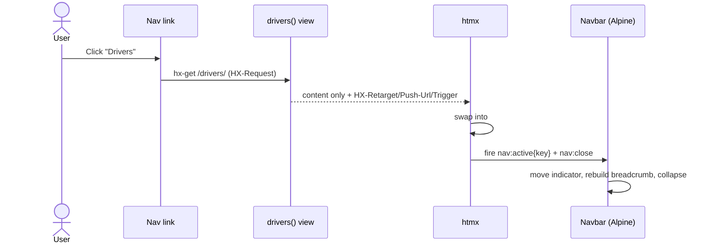

# Dashboard Actions

This page explains how the dashboard's **htmx swap actions** work — navigating between pages, drilling into detail views, and opening the trip drawer — and how a developer adds a new feature page that plugs into the shell.

Key points:
- The app shell (header, collapsing sidebar, breadcrumb, the one drawer) is rendered **once**; every subsequent action swaps a *region* of the page via [htmx], never a full reload.
- Views never write HTML, swap targets, or events. They pick a template and hand it data — the `Dashboard` helper sets the htmx response headers that decide *where* the response lands and *what* the navbar does.
- The active route is the **single source of truth** for what's selected; no page ever passes a title or breadcrumb.

---

## The big idea

`core` provides an htmx **app shell** that any feature plugs into. After the first full-page render, an "action" is an htmx request that swaps one of three regions. Which region — and what the navbar does afterwards — is driven entirely by HTMX response headers set in `core/dashboard.py`.

| Action | Helper | Lands in | Triggered by |
|---|---|---|---|
| **Navigate** to a page | `Dashboard.nav_response` | `#app_content` (+ pushes URL) | sidebar nav links |
| **Drill in** (same feature) | `core.dashboard.swap_content` | `#app_content` | a table row / "Back" button |
| **Open trip detail** | `core.views.show_trip` | `#trip_drawer_content` | `<c-trip-drawer-button>` |

---

## Who owns what (the dependency rule)

This is the architectural backbone:

- **`core`** owns the shell (the `Dashboard` class, `dashboard/base.html`, the navbar component) and **exactly one drawer** — the trip detail drawer. There is deliberately *no* generic "open any template in a drawer" helper, so no feature can slide arbitrary content over the page.
- **`app`** is the concrete dispatcher application. It creates the **one** `Dashboard` instance and wires its routes into the shell (`app/base.html`). It is a *thin loader*.
- **Features** (`trips`, `drivers`, `riders`) own their page templates and their own htmx endpoints (mounted at `<feature>/htmx/…`). They are **not** dashboards themselves.

The payoff: features depend on `core` only, **never on each other**. A drivers detail page can open a trip drawer without importing anything from `trips`, because it just drops a `core` component.

### Where it lives

- Shell helpers: `src/server/src/core/dashboard.py`
- Shell base template: `src/server/src/core/templates/dashboard/base.html`
- Navbar component: `src/server/src/core/templates/cotton/dashboard/navbar.html`
- The one drawer opener: `src/server/src/core/views.py`
- Trip drawer trigger component: `src/server/src/core/templates/cotton/trip_drawer_button.html`
- Host shell wiring: `src/server/src/app/dashboard.py`, `src/server/src/app/views.py`, `src/server/src/app/templates/app/base.html`
- Feature examples: `src/server/src/{trips,drivers,riders}/`

---

## Action 1 — Navigating to a page (`nav_response`)

The clever one: **the same view and URL serve two shapes**, and the request decides which. A typed-in URL and a nav-link click hit the exact same endpoint.

```python title="app/views.py"
def drivers(request):
    """Load the drivers feature's content (table + filters) into the shell."""
    return dashboard.nav_response(
        request,
        "drivers/pages/drivers.html",
        {"table": build_drivers_table(request)},
        key="drivers",
    )
```

- **Cold visit / refresh / back-forward** (no `HX-Request`, or an htmx history-restore): renders the **full shell** (`app/base.html`) with the content template already embedded in `#app_content` and the navbar indicator pre-lit for `key`. Land on the URL directly and the page is complete — indicator and breadcrumb included.
- **Live nav click** (htmx): renders **only** the content template, then sets headers so htmx swaps it into `#app_content`, pushes the URL into history, and fires events to move the navbar:

```python title="core/dashboard.py"
response["HX-Retarget"] = "#app_content"
response["HX-Reswap"] = "innerHTML"
response["HX-Push-Url"] = push_url or request.get_full_path()
response["HX-Trigger-After-Swap"] = json.dumps(
    {"nav:active": {"key": key}, "nav:close": True}
)
```

The sidebar link itself is dumb — a `<c-dashboard.nav-item>` that just does `hx-get` into `#app_content`. The navbar's Alpine state listens for `nav:active` to move the active indicator and rebuild the breadcrumb (by walking the sidebar DOM — see `computeCrumbs` in `navbar.html`), and `nav:close` to collapse the sidebar.

:::note
`<body>` carries `hx-history="false"`, so back/forward always re-fetch the URL from the server rather than restoring a stale DOM snapshot. That's safe precisely *because* the cold-visit branch returns a complete, correctly-lit shell.
:::



---

## Action 2 — Drilling in (`swap_content`)

Selecting a driver does **not** open a drawer — it replaces the main content with the detail page.

```python title="drivers/views.py"
def detail(request, pk):
    """htmx: transition #app_content to the driver's detail PAGE (not a drawer)."""
    driver = get_object_or_404(Driver.objects.select_related("account"), pk=pk)
    ...
    return swap_content(
        request,
        "drivers/pages/driver_detail.html",
        {"driver": driver, "stats": stats, "recent_trips": recent_trips},
    )
```

`swap_content` is the instance-free helper (depends on `core` only). It retargets `#app_content`, swaps innerHTML, and fires `nav:close`. The "Back to Drivers" button calls another endpoint that `swap_content`s the list back — so a feature returns to its own list **without referencing the host app's nav URL**. The entrance animation is pure CSS (`#app_content > *` keyframes in `base.html`), so neither the view nor the template has to opt in.

Filtering uses the same pattern at smaller scope: the filter bar `hx-get`s the feature's `htmx/table/` endpoint, which re-renders **just** the table partial into `#<feature>_table` — the shell and filter bar stay put while the rows refresh.

---

## Action 3 — Opening the trip drawer (`show_trip`)

The single drawer opener. It is hard-wired to one template — there is no template-path parameter, by design.

```python title="core/views.py"
def show_trip(request, hashid):
    """Render the trip detail into the shell's base drawer and slide it open."""
    trip = get_object_or_404(
        Trip.objects.select_related(*TRIP_SELECT_RELATED), hashid=hashid
    )
    response = render(request, "core/trip_detail.html", {"trip": trip, ...})
    response["HX-Retarget"] = "#trip_drawer_content"
    response["HX-Reswap"] = "innerHTML"
    response["HX-Trigger-After-Swap"] = "show-drawer"
    return response
```

The drawer panel stays mounted in `base.html` with Alpine state (`open: false`) listening for `show-drawer` / `close-drawer`. Features never wire any of this — they drop the component and pass a hashid:

```django-html
<c-trip-drawer-button trip_id="{{ trip.hashid }}" class="btn btn-soft">
    T-{{ trip.hashid }}
</c-trip-drawer-button>
```

That component is the *single place* that knows the `core_trip_drawer` URL and the drawer target. It's the whole reason the trips table and the drivers/riders detail pages can all open a trip without depending on each other.

---

## Per-page header actions

The header action buttons live in the persistent shell (outside `#app_content`), so a nav swap doesn't re-render them. To give **each nav item its own action set**, we reuse the navbar's active-key state instead of swapping markup.

The `actions` slot is rendered inside the navbar's Alpine root, so any markup there can call `isActive('key')` — the *same* function that lights the sidebar item and builds the breadcrumb. The `<c-dashboard.nav-actions>` component wraps a group of buttons and shows it only when its key is the active page:

```django-html title="cotton/dashboard/nav_actions.html"
<c-vars key="" />
<div x-show="isActive('{{ key }}')" x-cloak class="flex flex-row items-center gap-4">
    {{ slot }}
</div>
```

Drop one group per key into the host's `nav_actions` block:

```django-html title="app/base.html"

    <c-dashboard.nav-actions key="trips">
        <button class="btn btn-primary"><c-icons.add /> New Trip</button>
    </c-dashboard.nav-actions>
    <c-dashboard.nav-actions key="drivers">
        <button class="btn btn-primary"><c-icons.add /> Add Driver</button>
    </c-dashboard.nav-actions>

    {# Persistent across every page — e.g. the profile menu #}
    <div class="dropdown dropdown-end">…</div>

```

Why this works with zero view or event changes:

- **Cold load** — the server seeds `activeKey` from the page's `key`, so the matching group renders immediately (`x-cloak` hides the rest until Alpine initializes).
- **Nav swap** — the navbar already fires `nav:active{key}`, which updates `activeKey`; `x-show` is reactive, so the visible group flips automatically.
- A page whose key matches no group (e.g. home) shows none.

:::caution
Overriding `` replaces the navbar's **entire** default action area — which includes the profile dropdown. Anything that should persist on every page (like the profile menu) must be included in the block alongside the per-key groups, outside any `<c-dashboard.nav-actions>` wrapper.
:::

---

## How to implement a new feature page

Say you're adding a **Vehicles** page. Follow the established pattern.

### 1. Feature app — content + htmx endpoints only (no dashboard of its own)

```python title="vehicles/views.py"
def build_vehicles_table(request, queryset=None):
    # query + RequestConfig pagination, exposed so the host can build the
    # initial table for a full-page render (mirrors build_trips_table)
    ...

def table(request):
    # htmx filter endpoint: re-render vehicles/partials/vehicles_table.html
    # into #vehicles_table
    ...

def detail(request, pk):
    # drill-in: swap_content(request, "vehicles/pages/vehicle_detail.html", {...})
    ...
```

```python title="vehicles/urls.py"
urlpatterns = [
    path("htmx/table/", views.table, name="vehicles_htmx_table"),
    path("htmx/detail/<int:pk>/", views.detail, name="vehicles_htmx_detail"),
]
```

Mount it in `config.urls` under `vehicles/`. **No page route here** — the page is served by the host.

### 2. Templates

- `vehicles/pages/vehicles.html` — the content block: filter bar + table.
- `vehicles/partials/vehicles_table.html` — the swappable fragment, wrapped in `id="vehicles_table"`.
- `vehicles/pages/vehicle_detail.html` — the drill-in page.

The filter bar `hx-get`s `` into `#vehicles_table`; rows either `swap_content` to the detail page or drop a `<c-trip-drawer-button>`.

### 3. Host (`app`) — wire the page in (the thin loader)

```python title="app/views.py"
def vehicles(request):
    return dashboard.nav_response(
        request,
        "vehicles/pages/vehicles.html",
        {"table": build_vehicles_table(request)},
        key="vehicles",
    )
```

```python title="app/urls.py"
path("vehicles/", views.vehicles, name="app_vehicles"),
```

```django-html title="app/base.html"
<c-dashboard.nav-item label="Vehicles" key="vehicles"
                      url=""
                      target="#app_content">
    <c-icons.route />
</c-dashboard.nav-item>
```

:::tip The one rule to keep straight
The nav item's `key=`, the `key=` passed to `nav_response`, and the URL `name=` must all line up. That contract is what keeps the active indicator and breadcrumb correct.
:::

---

## Why this approach?

- **Single source of truth:** the active route drives the indicator and breadcrumb, so navigation can never desync from what's shown.
- **Clean separation:** views pick a template and hand it data; the shell owns every swap, animation, URL push, and event.
- **No cross-feature coupling:** features depend on `core` only. Opening a trip or returning to a list never references another feature's URLs.
- **Server stays authoritative:** every URL renders a complete, correctly-lit shell on a cold hit, so refresh and back/forward just work.

[htmx]: https://htmx.org/
