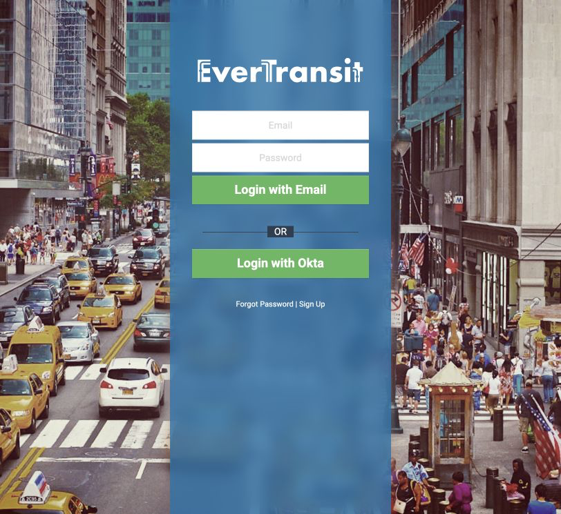
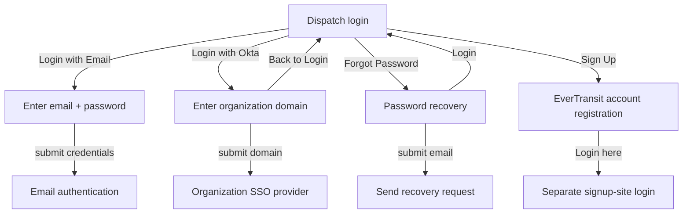
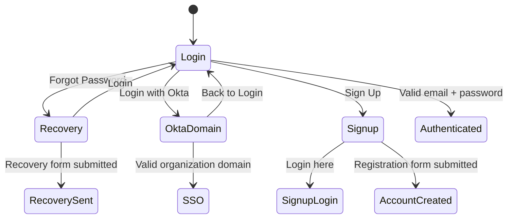
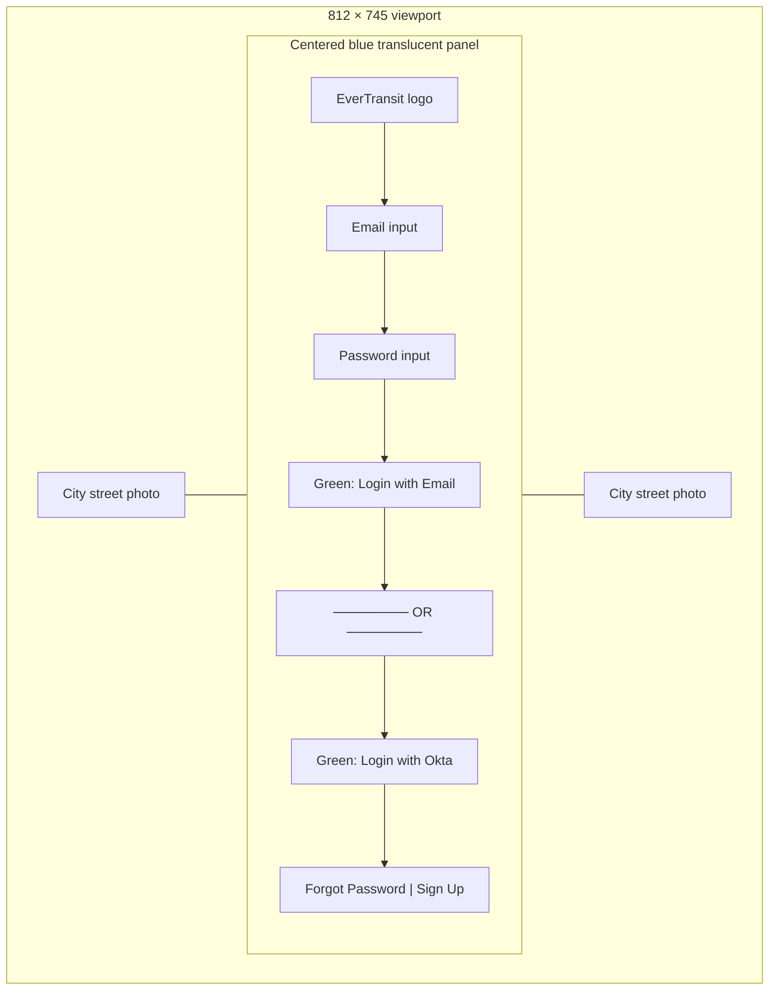
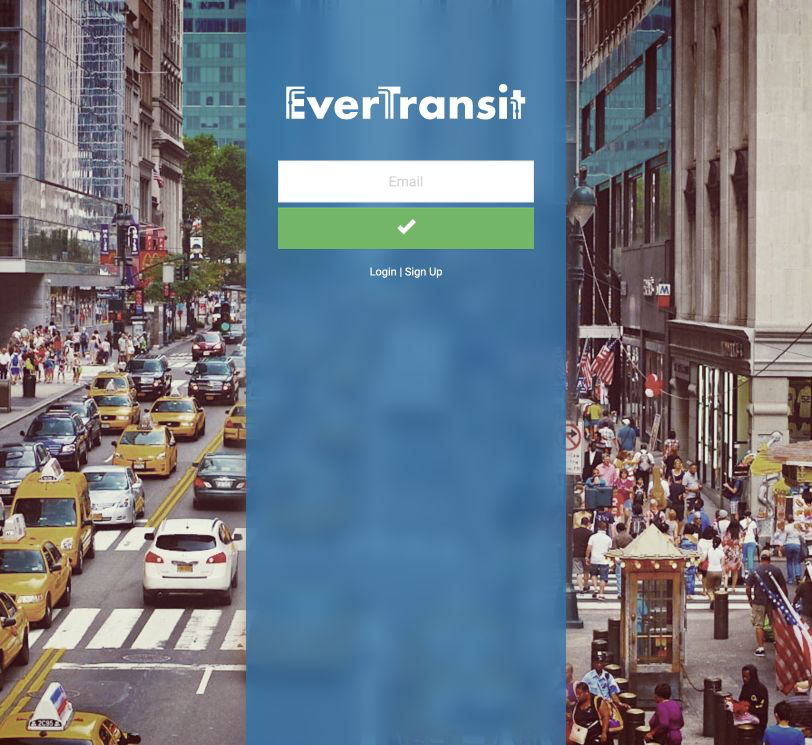
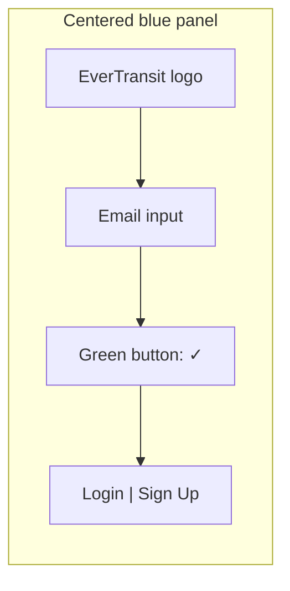
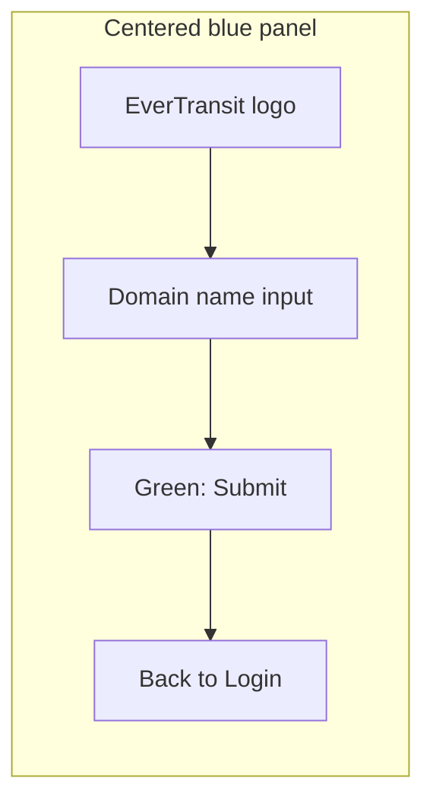
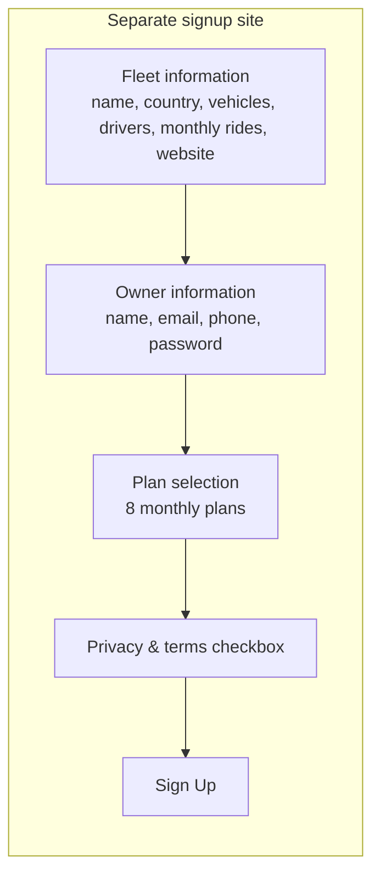

# EverTransit Dispatch — Login research

Captured 2026-07-23 from `https://dispatch.evertransit.com/#/login` at an 812 × 745 viewport. This is observational reference material for reproducing the interface; no credentials were entered and no login, recovery email, or account-registration form was submitted.

## Captures

| State | Capture | Notes |
| --- | --- | --- |
| Default login | [login-default-viewport.png](login-default-viewport.png) | The primary reference screen. |
| Password recovery | [forgot-password.png](forgot-password.png) | Empty recovery form. |
| Recovery email entered | [forgot-password-email-entry.png](forgot-password-email-entry.png) | Focused email field; the entered value is non-deliverable research data. |

## User flow

Email authentication, recovery delivery, SSO authentication, and registration submission were intentionally not completed because they transmit data or create external account activity.

## Observed UI transitions

## Screen inventory

### 1. Login

- Full-height city-street photos frame a centered, translucent blue column.
- White EverTransit logo is centered near the top of the column.
- Two 256px-wide stacked fields: `Email`, then `Password`.
- Full-width green primary button: `Login with Email`.
- A centered `OR` sits over a thin horizontal divider.
- A second green button: `Login with Okta`.
- Text links at the bottom: `Forgot Password | Sign Up`.

### 2. Password recovery

- Reuses the same background photographs, centered blue panel, and logo.
- Contains a single `Email` field and a green icon-only confirmation button with a checkmark.
- Footer links are `Login | Sign Up`.
- Focusing or filling the field produces an orange focus outline.

### 3. Organization-domain (Okta) screen

The `Login with Okta` control stays on the Dispatch URL and swaps the view to an organization-domain prompt.

- One `Domain name` input.
- A green `Submit` button.
- `Back to Login` link.

### 4. Account registration destination

`Sign Up` navigates to `https://signup.evertransit.com/`, a separate, white registration site. It presents fleet information, owner information, plan selection, privacy/terms acceptance, and a final `Sign Up` action. Its registration form was not populated or submitted.

## Replication notes

- Preserve the vertical, photo–panel–photo composition at the captured desktop width.
- The blue panel is intentionally soft/blurred; it is not a flat solid color.
- Both authentication choices are visually equal green calls to action, separated only by `OR`.
- Sign-up is a cross-site navigation rather than an in-place Dispatch screen.
- Automated browser capture timed out while rendering the Okta-domain and registration pages; their wireframes and control lists above are based on their visible DOM states.
